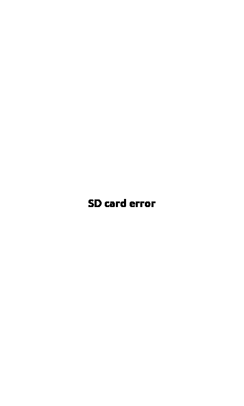
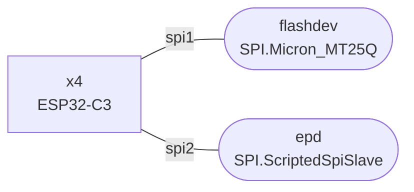

## This fork: CrossPoint running in a simulator (partial)

Simantic's fork of CrossPoint, kept as a simulation showcase. The `sim/` directory runs the real firmware
(`default` env, ESP32-C3, Xteink X4/X3 binary) on a simulated ESP32-C3 with a simulated SSD1677 e-paper panel.
Nothing here is offered back or posted upstream. The firmware sources are unchanged; there are no firmware edits.

**Status: boots and draws one real e-paper frame, the "SD card error" screen. The SD card is not wired in yet,
so the firmware never reaches home or the library.**



Frame 1: the firmware's own "SD card error" screen, captured from the panel peer's BW RAM on the first display
refresh at 3.026 s virtual time (the firmware logs `SD card initialization failed` at 2.906 s and enters
`FullScreenMessage` at 2.947 s). `default` env at `develop` 5c37b123, `sim` 0.10.0 (build f219eb31), panel only,
no SD card. 480x800, rendered from the dump with `frame2png.py --transpose`. A real frame, not a mock-up.

```sh
sim/build.sh        # PlatformIO build of the unmodified default env
sim/run.sh          # 8 virtual s; asserts a frame was captured and is not blank; PNG in sim/out/
```

**What runs** (`sim` 0.10.0, build f219eb31, 2026-11-16):

| Part | In the simulation |
| --- | --- |
| Firmware | `pio run -e default`, flash image `firmware.factory.bin`, booted through the built-in C3 mask ROM |
| ESP32-C3 | released `sim ESP32-C3` model; scenario `sim/scenario.yaml`, overlay `sim/epd.board` |
| Panel | `sim/peers/ssd1677.py`, a vendored Python SSD1677 peer: BW and RED RAM, RAM window and counters (0x11, 0x44, 0x45, 0x4E, 0x4F), dumps a PBM on 0x20 when 0x22 bit 2 is set; BUSY 1.6 s (full refresh) / 150 ms |
| SD card, buttons, I2C parts | not working or not present, see below |

System graph (`sim graph --scenario sim/scenario.yaml`):



**Configurations tried** (measured, this build):

| Configuration | Where | Wall | Result |
| --- | --- | --- | --- |
| Panel peer only (`sim/scenario.yaml`) | `sim/run.sh` | 8.0 s for 8 virtual s | PASS: 1 frame, "SD card error", frame at 3.026 s; `FullScreenMessage` at 2.947 s; X3 I2C probe fails, X4 branch taken |
| Panel + SD peer behind `SPI.SPIMultiplexer` (`sim/scenario-sd.yaml`, `SD=1 sim/run.sh`) | not passing | 7.6 s for 12 virtual s | no frame at all, `SD card not detected (err=0x01 data=0xFF cs=12 ...)` at 2.906 s |
| `env:sim` (UART0 console) | not kept | n/a | does not build: `ARDUINO_USB_CDC_ON_BOOT` redefined (`-Werror`) |

**Gaps, with the evidence:**
- **SD card not reachable.** With the multiplexer (CS pads GPIO21 and GPIO12 into slots 0 and 1, `ActiveLowMask` 3,
  then 0) a debug copy of both peers saw 3 to 4 `on_select` calls on the SD peer and zero `on_transmit` bytes on
  either peer; the panel peer alone, directly on `spi2`, gets its bytes. So bytes do not reach children of the
  multiplexer on this ESP32-C3 SPI2 controller in 0.10.0. Two honest attempts, then stopped; not root-caused
  (engine side, not changed here). Because the panel is also behind the multiplexer in that run, no frame is drawn.
  The SD peer (`sim/peers/sd_spi.py`, adapted from a SPI-mode SD model, reads a FAT image named by `$SD_IMAGE`) and
  `sim/mkepub.py` (self-written one-chapter EPUB) are kept for when this works; `unverified`: the SD peer has not
  answered a single command on this firmware.
- **Home, library and reader screens: not captured** (they need the SD card). No other frames exist; no GIF.
- **Buttons** are an ADC resistor ladder on ADC1/ADC2; driving them during a run was not tried: `unverified`.
- **Grayscale** (custom LUT, RED plane composing) is not modelled in the peer; only the BW plane is dumped.
- Pins: SCLK 8, MOSI 10, EPD CS 21, DC 4, RST 5, BUSY 6, SD MISO 7, SD CS 12, power GPIO3.

Build traps: PlatformIO Core 6.1.18 is refused by the pioarduino platform; 6.2.0 fails with
`No module named 'SCons.Tool.FortranCommon'`; with 6.1.19 the first full build failed with that SCons message at
the link step and the re-run succeeded (about 6 min then 4 min). `freeink-sdk` is a submodule (`sim/build.sh`
initialises it). Use a scratch `PLATFORMIO_CORE_DIR` (8.7 GB). `sim/frame2png.py` and `sim/frames2gif.py` are
stdlib converters for the PBM dumps.

**Licence.** `LICENSE` is MIT ("covers original CrossPoint code, except where a file states other terms";
third-party code keeps its own licences; the combined firmware executable is GPLv3 because it includes wolfSSL;
see `licenses/README.md`). GitHub reports the key as `other` because of that addendum.
