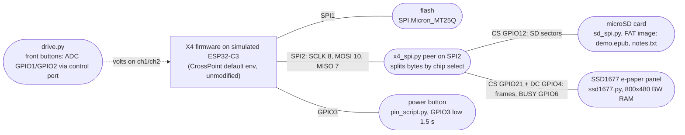
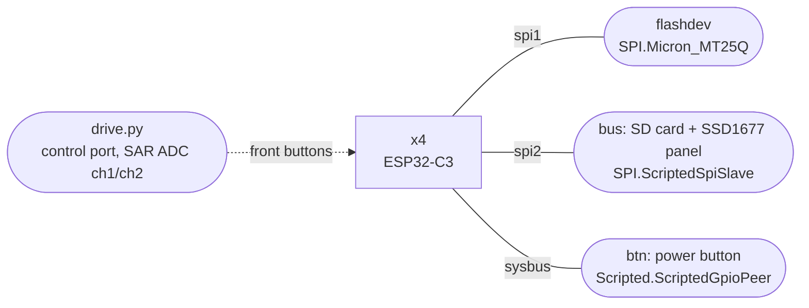

## This fork: CrossPoint running in a simulator

Simantic's fork of CrossPoint, kept as a simulation showcase. The `sim/` directory runs the real firmware
(`default` env, ESP32-C3, Xteink X4/X3 binary) on a simulated ESP32-C3 with a simulated microSD card and a simulated
SSD1677 e-paper panel, and drives the front buttons. Nothing here is offered back or posted upstream. The firmware
sources are unchanged; there are no firmware edits.

**Status: boots, finds the SD card, shows the home screen and the file browser, opens an EPUB and turns pages
with the simulated buttons.** Every image below is a real panel frame from the run (dumped from the panel peer's BW
RAM at each display refresh), not a mock-up.

| Home | File browser | Reader, page 1 | Page 2 | Page 3 |
| --- | --- | --- | --- | --- |
|  |  |  |  |  |

An animated walkthrough of the same five frames is [sim/screenshots/walkthrough.gif](sim/screenshots/walkthrough.gif).
Before this work the fork showed one frame, the "SD card error" screen
([sim/screenshots/01-sd-card-error-before.png](sim/screenshots/01-sd-card-error-before.png)).

Scenario behind the walkthrough (`sim/x4.board`, from the board file, `sim/peers/*.py` and `sim/drive.py`):



```sh
sim/build.sh        # PlatformIO build of the unmodified default env
sim/run.sh          # ~40 s wall: boots, presses buttons, converts frames to PNG in sim/out/, checks activities
```

**What runs** (`sim` 0.10.0, build f219eb31, `develop` 5c37b123 plus `sim/`, 2026-11-16):

| Part | In the simulation |
| --- | --- |
| Firmware | `pio run -e default`, flash image `firmware.factory.bin`, booted through the built-in C3 mask ROM |
| ESP32-C3 | released `sim ESP32-C3` model, board file `sim/x4.board` |
| SD card | `sim/peers/sd_spi.py`, a Python SD card in SPI mode (CMD0, 8, 55/41, 58, 16, 17/18, 24/25, ...) over a FAT image built by `sim/run.sh` with `mformat`/`mcopy` (`demo.epub` from `sim/mkepub.py`, `notes.txt`) |
| Panel | `sim/peers/ssd1677.py`, a vendored Python SSD1677 peer: BW and RED RAM, RAM window and counters, dumps a PBM on 0x20 when 0x22 bit 2 is set; BUSY 1.6 s (full refresh) / 150 ms |
| SPI2 bus | `sim/peers/x4_spi.py`: one peer on `spi2` that sends each byte to the SD card or the panel by reading both chip-select pads (GPIO12, GPIO21). MODELED SIMPLIFICATION, see gap 1 |
| Buttons | `sim/drive.py` sets the SAR ADC pad voltages through `--control-port` (`saradc` properties `ch1`, `ch2`); power button GPIO3 is a scripted GPIO peer. MODELED SIMPLIFICATION: the volts per button are the middle of the firmware's ADC bands, not a measured ladder |

System graph (`sim graph`, with `sim/x4.board`):



**Configurations tried** (measured, this build, 2026-11-16):

| Configuration | Result |
| --- | --- |
| `sim/x4.board`, `sim/run.sh` (SD + panel on one peer, buttons via control port) | PASS: `SD card detected` at 0.908 s; Home at 2.72 s; FileBrowser at 4.45 s; EpubReader after the second Confirm; 10 panel refreshes; reader pages `1/7 14%`, `2/7 29%`, `3/7 43%` reached with the Right button |
| Panel peer only (`sim/scenario.yaml`) | one frame, "SD card error" (the earlier state of this fork) |
| SD peer and panel behind `SPI.SPIMultiplexer` (`MUX=1 sim/run.sh`, `sim/scenario-sd.yaml`) | not working: `SD card not detected (err=0x01 data=0xFF cs=12 ...)`, no frame |
| Native `SPI.SDCard` (`imageFile`) at mux slot 1 | not working: same `SD card not detected` message |
| Same Python SD peer attached directly to `spi2` (no mux) | works: `SD card detected` at 0.908 s |
| Scripted GPIO peer line wired to `saradc@N` as a button | no effect (run timeline identical to a run without it) |
| `env:sim` (UART0 console) | not kept: does not build, `ARDUINO_USB_CDC_ON_BOOT` redefined (`-Werror`) |

**Gaps, with the evidence** (engine or model side; not changed here, no issues filed):
1. **`SPI.SPIMultiplexer` children never receive bytes on ESP32-C3 SPI2 (0.10.0).** `--frames /tmp/f --frames-only spi2`
   logs 98,244 SPI transfers tagged `(spi2 → sd)` in 4 virtual s, including `40 00 00 00 00 95` (CMD0), so the bus
   routes to the child. A debug copy of the Python SD peer printed `on_select` 3 times and `on_transmit` 0 times.
   The native `SPI.SDCard` behind the same mux reports no card. The same peer attached directly to `spi2` gets every
   byte and the firmware logs `SD card detected`. Hence the one-peer workaround above, which reads the two CS pads
   itself. Not root-caused.
2. **No analog drive from scripted peers.** A `Scripted.ScriptedGpioPeer` line into `saradc@1`/`@2` did not change
   what the firmware read. `Analog.Potentiometer` works but is static; the only runtime path found is the write-only
   `ch1`/`ch2` properties of `saradc` on `--control-port` (calibration: with `saradc: fullScale: 3.3`, a pot at 50 %
   reads raw 0x800 and at 100 % 0xFFF, traced with `--trace-symbol InputManager::getButtonFromADC`). The unit of `ch`
   is volts (3.3 idle; the same script in mV did not press).
3. **`--control-port` excludes `--trace-symbol` and every other plain-run tracer** (error text from `sim`), so the
   button run cannot be traced in the same run; tracing was done in separate plain runs.
4. **A released power-button line reads as held.** After the scripted press ends, the line must be driven high
   (`idle` level 1 in `x4.board`); left released the firmware kept seeing the power button (`Screenshot saved`, then
   no input). Cause not confirmed (pad pull model vs firmware): `unverified`.
5. **Presses are timed in wall-clock time** (`--real-time`), so the virtual time of each press moves between runs
   (EpubReader entered at 10.9 s in one run, 18.7 s in another). The results above are not bit-reproducible;
   `unverified` that a fixed virtual-time press schedule exists in the released sim.
6. **Panel peer shows only the BW plane.** Some refreshes after a page turn (frames 6, 8, 10 in a run) dump an
   inverted or ghosted image: the firmware's refresh sequence uses the RED plane and a custom LUT, which the peer does
   not model. Those frames are not in the screenshots; `unverified` that this is the whole explanation.
7. Pins: SCLK 8, MOSI 10, EPD CS 21, DC 4, RST 5, BUSY 6, SD MISO 7, SD CS 12, power GPIO3, buttons ADC GPIO1/GPIO2.

Build notes: PlatformIO Core 6.1.18 is refused by the pioarduino platform; 6.2.0 fails with
`No module named 'SCons.Tool.FortranCommon'`; with 6.1.19 the first full build failed with that message at the link
step and the re-run succeeded (about 6 min, then 2 min). `freeink-sdk` is a submodule (`sim/build.sh`
initialises it). Use a scratch `PLATFORMIO_CORE_DIR` (the toolchains are several GB). `sim/frame2png.py` and
`sim/frames2gif.py` are stdlib converters for the PBM dumps; `sim/ctl.py` is a stdlib WebSocket client for the control
port.

**Licence.** `LICENSE` is MIT ("covers original CrossPoint code, except where a file states other terms";
third-party code keeps its own licences; the combined firmware executable is GPLv3 because it includes wolfSSL;
see `licenses/README.md`). GitHub reports the key as `other` because of that addendum.
